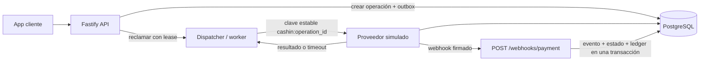

# Ligo Wallet Cash-In

Implementación de la prueba Backend Senior: una recarga de billetera con idempotencia persistente, procesamiento recuperable y acreditación atómica del saldo.

## Arquitectura



La API usa Fastify y TypeScript. PostgreSQL es la fuente de verdad para las operaciones, claves de idempotencia, outbox, eventos y ledger. El proveedor local simulado tiene su propia tabla persistente para representar la deduplicación que se espera de un proveedor real.

### Plan de implementación

1. Traducir el enunciado a invariantes y fallos posibles: doble envío, concurrencia, timeout incierto, webhooks repetidos y reinicios.
2. Definir los contratos HTTP y los estados de una recarga antes de conectar el proveedor.
3. Usar PostgreSQL como fuente de verdad para idempotencia, outbox, saldo y ledger.
4. Despachar pagos fuera de la transacción SQL, reutilizando una clave estable del proveedor y conservando `PENDING` cuando el resultado es incierto.
5. Aplicar respuestas y webhooks mediante una sola máquina de estados y transacciones financieras atómicas.
6. Validar con PostgreSQL real, múltiples instancias de aplicación, pruebas de integración y ejecución local con Docker.

El historial de decisiones, correcciones y dificultades de ejecución está en [docs/ai-usage.md](docs/ai-usage.md). La evidencia visual de Postman, PostgreSQL y la suite automatizada está en [el informe Word](entrega/Evidencia-pruebas-Ligo-Cash-In.docx).

### Invariantes financieras

- El monto se convierte a unidades menores enteras (`bigint`) y la base de datos usa `bigint`; no se usa `float` para dinero.
- `(user_id, idempotency_key)` es único. La huella SHA-256 incluye usuario, monto, moneda y método de pago.
- Una clave repetida con el mismo contenido recupera la operación. La misma clave con contenido diferente responde `409`.
- El proveedor recibe siempre `cashin:<operation_id>` como clave idempotente. Los reintentos no generan una identidad de pago nueva.
- El saldo se incrementa con una actualización atómica de PostgreSQL y se registra un movimiento de ledger con restricción única por operación, dentro de la misma transacción que completa la operación.
- Crear la operación y su mensaje de outbox es una sola transacción. El worker reclama mensajes con un lease atómico y vuelve a intentar con espera exponencial limitada.
- No se mantiene una transacción SQL abierta mientras se espera al proveedor.

### Estados y eventos

| Estado actual | Evento entrante | Resultado |
| --- | --- | --- |
| `PENDING` | `PENDING` | Sigue pendiente |
| `PENDING` | `SUCCEEDED` | Acredita y completa en una transacción |
| `PENDING` | `FAILED` definitivo | Marca fallida sin acreditar |
| `SUCCEEDED` | `PENDING` antiguo o `SUCCEEDED` repetido | Conserva el estado y no duplica el ledger |
| `FAILED` | `PENDING` antiguo o `FAILED` repetido | Conserva el estado |
| `SUCCEEDED` ↔ `FAILED` | Resultado terminal contradictorio | Conserva el estado y crea un caso de reconciliación |

Un timeout significa que el resultado es incierto: la operación continúa en `PENDING`. Si el proveedor ya cobró, el mismo `provider_idempotency_key` permite recuperar el resultado. Si no ofrece idempotencia durable, no es posible prometer exactamente una ejecución externa; haría falta reconciliación con su API y sus garantías.

## Contratos HTTP

### `POST /cash-in`

Headers requeridos:

```text
Content-Type: application/json
Idempotency-Key: <UUID>
```

Body compatible con el ejemplo del enunciado:

```json
{
  "user_id": "usr_abc123",
  "amount": 100.00,
  "currency": "PEN",
  "payment_method": "card_xyz"
}
```

Respuesta completada (`200`):

```json
{
  "operation_id": "<uuid>",
  "status": "completed",
  "amount": "100.00",
  "currency": "PEN",
  "new_balance": "350.00"
}
```

Los montos de respuesta son cadenas decimales para conservar exactitud. Otros resultados:

- `202 Accepted`: operación pendiente; reintentar con la misma clave.
- `422 Unprocessable Entity`: rechazo definitivo; no se acredita saldo.
- `409 Conflict`: clave ya usada con otro cuerpo o moneda incompatible con la billetera.
- `400 Bad Request`: clave o cuerpo inválido.

Cada respuesta incluye `x-correlation-id`. Los errores incluyen el mismo identificador como `request_id`.

### `POST /webhooks/payment`

El evento contiene `event_id`, `operation_id`, `status`, `occurred_at` y, para éxito, `provider_payment_id`. `provider_sequence` y los datos de rechazo son opcionales.

El webhook requiere:

```text
x-payment-timestamp: <epoch en segundos>
x-payment-signature: sha256=<hex>
```

La firma es HMAC-SHA256 de `timestamp + "." + cuerpo HTTP crudo`, usando `WEBHOOK_SECRET`. Se rechazan firmas inválidas o con más de cinco minutos de antigüedad. El evento, la transición y cualquier efecto financiero se confirman en una sola transacción. Si falla la base de datos, la transacción se revierte y el proveedor puede reintentar.

## Ejecución local

Requiere Node.js 22.12 o posterior y Docker Compose.

En Windows, el proyecto incluye el código fuente del lanzador en `launcher/`. Compílalo siguiendo la sección [Generar el lanzador Windows](#generar-el-lanzador-windows). Después, ejecuta `artifacts/windows/LigoCashIn.exe` desde la carpeta raíz. El lanzador comprueba Node.js 22.12+ y Docker Desktop, crea `.env` desde `.env.example` si hace falta, inicia PostgreSQL, aplica migraciones, carga la billetera de demostración e inicia la API. Mantén abierta la consola mientras usas la URL que muestra el lanzador (por defecto `http://localhost:3000`).

```powershell
Copy-Item .env.example .env
docker compose up -d postgres
npm ci
npm run migrate
npm run seed
npm run dev
```

La billetera de demostración `usr_abc123` comienza con `PEN 250.00`. El proveedor simulado usa `FAKE_PROVIDER_OUTCOME=success` por defecto. Valores disponibles:

- `success`: confirma el pago.
- `declined`: registra un rechazo definitivo.
- `timeout-after-charge`: guarda un único cobro y pierde la respuesta; el reintento recupera ese mismo cobro.
- `timeout-before-charge`: deja la operación pendiente sin registrar un cobro; se recupera al reiniciar con un resultado exitoso.

Para probar los endpoints, usa el `Idempotency-Key` de ejemplo:

```powershell
curl.exe -X POST http://localhost:3000/cash-in `
  -H "Content-Type: application/json" `
  -H "Idempotency-Key: 123e4567-e89b-12d3-a456-426614174000" `
  -d '{"user_id":"usr_abc123","amount":100.00,"currency":"PEN","payment_method":"card_xyz"}'
```

## Pruebas

`npm test` ejecuta pruebas de integración contra PostgreSQL real. Configura `TEST_DATABASE_URL` para una base de datos de pruebas separada; la suite limpia sus tablas antes de cada caso. Nunca apuntes `TEST_DATABASE_URL` a datos que quieras conservar.

Con Docker Compose, el contenedor crea `ligo_cash_in_test` al inicializar un volumen nuevo. Si el volumen ya existía antes de agregar esa base, créala una vez con:

```powershell
docker compose exec postgres createdb -U challenge ligo_cash_in_test
```

```powershell
npm test
npm run typecheck
npm run build
npm audit
```

La suite cubre éxito, rechazo, repetición y conflicto de idempotencia, dos instancias concurrentes con pools separados, timeout tras cobro, webhook duplicado, eventos atrasados y contradictorios, carrera entre respuesta y webhook, recuperación con una instancia nueva, firma expirada y precisión de montos.

## Generar el lanzador Windows

El código fuente del lanzador está en `launcher/` y requiere .NET 9 SDK para compilarse. Desde la carpeta raíz del proyecto:

```powershell
dotnet publish .\launcher\LigoCashIn.Launcher.csproj -c Release -r win-x64 --self-contained true -p:PublishSingleFile=true -o .\artifacts\windows
```

Esto genera `artifacts/windows/LigoCashIn.exe`. El lanzador debe ejecutarse desde la carpeta del proyecto para encontrar `package.json` y `scripts/start-local.ps1`.

## Datos y recuperación

- `wallets`: saldo entero por usuario y moneda.
- `cash_in_operations`: petición, estado, hash, clave del proveedor y resultado.
- `payment_outbox`: trabajo pendiente, lease, intentos y próxima ejecución.
- `ledger_entries`: crédito único y saldo resultante de esa operación.
- `provider_webhook_events`: deduplicación y disposición de cada evento.
- `reconciliation_cases`: estados terminales contradictorios para revisión.
- `simulated_provider_payments`: almacenamiento del proveedor local para probar idempotencia tras reinicios.

El `user_id` del body simula la identidad del usuario para esta prueba y no es autenticación de producción. En producción se obtendría del token autenticado. El proveedor simulado comparte la base local por simplicidad; un adaptador real debe conservar la clave estable, consultar el resultado del pago y permitir reconciliación.

## Uso de IA y revisión crítica

El PDF permite y espera el uso de un agente de IA, y evalúa la calidad de las especificaciones y la revisión crítica de sus respuestas. El registro de prompts, plan, decisiones, problemas encontrados y correcciones está en [docs/ai-usage.md](docs/ai-usage.md).
